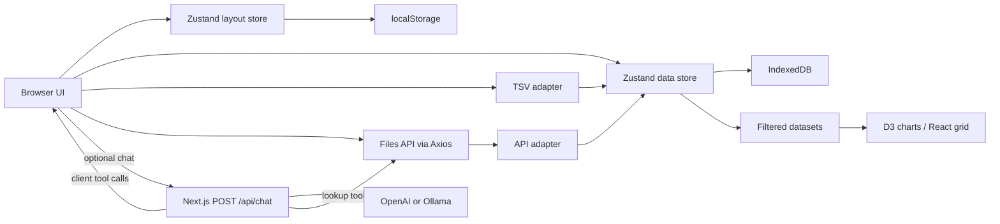

# Technical reference

[Back to README](README.md)

This reference supports operational troubleshooting and small maintenance changes. See [configuration](docs/configuration.md) for environment variables and deployment configuration references.

## Architecture



The visible application uses the Pages Router (`src/pages/index.tsx`, `_app.tsx`). The homepage is compatible with prerendering and has no `getServerSideProps`. The App Router hosts the optional chat endpoint at `src/app/api/chat/route.ts`. Static hosting only serves frontend assets; it cannot run that endpoint.

## Runtime dependencies

The application is Next.js 15 / React 19 / TypeScript, with D3 charts, Zustand stores, TanStack Query for API queries, Axios, IndexedDB via `idb`, and `react-grid-layout`. `html-to-image` captures PNGs. The AI SDK and OpenAI/Ollama adapters support chat and structured tool calls. Tailwind/PostCSS and the bundled Inter font provide styling.

Use `package-lock.json` with `npm ci` for the resolved dependency tree. Several package ranges are `latest`; regenerating the lockfile or using an unrestricted update can change much more than intended. Docker and CI use Node 22. There is no separate dashboard database, database migration tool, background worker, or login service in this repository.

## Source map

| Location | Responsibility |
| --- | --- |
| `src/pages/index.tsx` | Page composition, build-time assistant UI flag, dashboard JSON import |
| `src/pages/_app.tsx` | Query provider, styles, production analytics |
| `src/components/sidebar/` | Dataset import/filter/split controls and dashboard management/export |
| `src/components/layout/` | Grid, chart container, titles, export controls, shared inputs |
| `src/components/viz/charts/` | Individual chart renderers |
| `src/adapters/` | TSV/API normalization, feature-type inference and chart eligibility |
| `src/services/apiService.ts` | Shared Files API URL and endpoints, used by browser and assistant server tools |
| `src/store/useDataStore.ts` | Datasets, manifests, filters, IndexedDB persistence |
| `src/store/useLayoutStore.ts` | Dashboard layouts, chart configuration, localStorage persistence |
| `src/hooks/useDatasetFromUrl.ts`, `useDatasetDeepLink.ts` | Dataset URL parsing/loading and chart wiring |
| `src/lib/ai/`, `src/app/api/chat/route.ts` | Provider validation, model construction, chat tool definitions |
| `src/components/chat/AppChatPanel.tsx` | Chat UI and execution of client-side dataset/dashboard tools |
| `src/lib/dashboard/` | Converting feature recommendations into chart configurations |
| `src/utils/graphFeatureUtils.ts` | Graph parsing, aggregation, Sankey conversion |
| `src/lib/chartImageExport.ts`, `chartTitle.ts` | PNG/clipboard utilities and automatic title handling |
| `src/types/globals.d.ts` | Shared dataset, feature, manifest and filter types |

`src/services/cacheService.ts` contains TODO stubs, not a working TTL cache. Legacy `src/requests/`, `src/enums/`, `src/config/config.js.template`, and the Makefile are not the supported modern setup path. Consult their callers before reusing them. The PRD is historical design intent, not a testable inventory of shipped capabilities.

## Data and persistence

Both adapters normalize inputs to `GameData`: identity and source metadata, rows, column types, supported charts, and optional filters/details. TSV input uses D3 auto-typing and filename metadata; the API adapter consumes `val.rows` and `val.columns` and converts null cells to the string `"null"`. Graph detection scans beyond the first row; ordinary numeric/categorical inference uses the first row.

Datasets and manifests persist in IndexedDB (`ogd-data-store`, store `store`). Layouts persist through Zustand's default localStorage persistence (`ogd-layout-store`). Both persistence schemas currently use version 1. On dataset hydration, metadata is recomputed for graph/chart support. There is no periodic cache expiry. Changes to this data shape should account for saved browser state and JSON exports.

The UI's version-2 JSON export contains a single dashboard plus datasets referenced by its charts. Import merges by IDs. The older store-level serializer is layout-only. Do not confuse persistence schema version 1 with export format version 2.

## Assistant execution

The public flag determines whether the panel is bundled as visible. `/api/chat` independently checks the server flag and provider configuration before accepting messages. Lookup and recommendation tools execute on the server; dataset loading and dashboard application execute through client tools against the browser stores. The shared API URL is also compiled into the frontend and should be consistent with server configuration.

The current route does not implement user authentication, per-user quotas, or application-level rate limiting. Cloud Run is deployed publicly by the existing workflows. Review access and usage controls before enabling a paid provider on a shared service.

## Tests and verification limits

```bash
npm test -- --runInBand --coverage=false
npm run lint
DEPLOY_TARGET=cloudrun npm run build
DEPLOY_TARGET=static npm run build
```

Run builds sequentially with the development server stopped. Build commands type-check and compile; they do not replace a browser smoke check. No app behavior tests need to be added for a documentation-only edit.

Focused Jest suites cover assistant availability, chat activity, dashboard recommendations, adapter graph detection, graph aggregation, chart titles, and image-export helper behavior. The full-page test in `tests/sample.test.tsx` is skipped. Jest maps D3 and `d3-*` imports to a minimal mock, so passing tests do not verify actual D3 rendering. PNG helper tests do not prove browser screenshot/clipboard behavior.

Cypress currently contains a placeholder page visit under `cypress/integration`, while configuration does not explicitly set that older spec location. It is not an established end-to-end regression suite and is not run by the validation workflow.

At the feature-port checkpoint, 46 tests passed and one was skipped; both builds passed. Lint reported 131 errors and 65 warnings. CI reports lint without blocking and Next.js skips build-time lint. Track subsequent improvements rather than treating that baseline as a desired steady state.

When making small changes, start with the relevant focused tests and run the synthetic-data browser check. Changes to deployment configuration require both targets and the actual deployment-path smoke checks. Changes to persistence/export require recovery checks with existing browser data and older exports.
